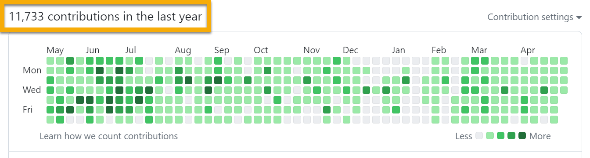

> Load, expand, and compose environment variables from a deterministic dotenv cascade, then execute commands under that context. Use get‑dotenv as a library, a CLI, or a plugin‑first host to build dotenv‑aware tooling with cross‑platform shell control, CI‑friendly capture, and clear diagnostics.

# get-dotenv

[](https://www.npmjs.com/package/@karmaniverous/get-dotenv)

[](https://docs.karmanivero.us/get-dotenv)
[](./CHANGELOG.md)
[](./LICENSE)

get‑dotenv helps you:

- Load and merge env vars from a deterministic cascade (global/env × public/private) across multiple paths.
- Expand values with defaults; a referenced value is used as composed, never expanded twice.
- Add dynamic variables (JS/TS) that compute from the composed env.
- Run commands with normalized shell behavior and a consistent child environment.
- Compose your own CLI from shipped plugins or your own.
- Give any command's option anywhere on the command line with its qualified name (`--vc-env`, `--vc-aws-profile`), so you can add options to the end of an npm script.

Upgrading from 7.x? See [Migrating to 8.0](./guides/migrating-to-8.md).

See full guides:

- [Getting started](./guides/getting-started.md)
- [Migrating to 8.0](./guides/migrating-to-8.md) (every breaking and behaviour change from 7.x)
- [Qualified options](./guides/qualified-options.md) (options anywhere on the command line)
- [Config and overlays](./guides/config.md) (dynamic, validation, defaults):
- [Dotenv editor (format-preserving)](./guides/dotenv-editor.md)
- [Shell execution behavior, quoting, capture, exit codes](./guides/shell.md)
- [Shipped plugins](./guides/shipped/index.md)
- [Authoring plugins](./guides/authoring/index.md) (host, lifecycle, exec, diagnostics)

## Use Cases

- Execute deployment steps across many repositories from one command sequence. See [batch plugin guide](./guides/shipped/batch.md)
- Run config‑driven, environment‑aware operations with simple CLI commands. See [config guide](./guides/config.md)
- Compose a rich CLI from shipped and third‑party plugins and share it across projects. See [shipped plugins overview](./guides/shipped/index.md)
- Drive complex AWS workflows in an authenticated, environment‑aware context. See [aws plugin guide](./guides/shipped/aws.md)
- Scaffold a project config and a host‑based CLI skeleton in seconds. See [init plugin guide](./guides/shipped/init.md)
- Batch lint/build/test across a monorepo with deterministic output. See [batch plugin guide](./guides/shipped/batch.md)
- Run cross‑platform commands in CI with normalized shells and capture. See [shell guide](./guides/shell.md)
- Programmatically compose env and run tools inside Node scripts. See [Getting started](./guides/getting-started.md)
- Add observability without leaking secrets using trace, redaction, and entropy warnings. See [diagnostics guide](./guides/authoring/diagnostics.md)
- Author new plugins with maximum DX and minimal boilerplate. See [authoring plugins guide](./guides/authoring/index.md)

## Requirements

- Node.js ≥ 22.12.0 (this repository pins 22.23.5 for CI/reproducibility)

## Installation

```bash
npm install @karmaniverous/get-dotenv
```

## Quick Start

Run a one‑off command with your env (parent alias so flags apply to getdotenv):

```bash
npx @karmaniverous/get-dotenv -c 'node -e "console.log(process.env.APP_SETTING ?? \"\")"'
```

Load programmatically:

```ts
import { getDotenv } from '@karmaniverous/get-dotenv';

const vars = await getDotenv({ env: 'dev', paths: ['./'] });
console.log(vars.APP_SETTING);
```

Embed a CLI quickly (shipped plugins wired for you):

```ts
#!/usr/bin/env node
import { createCli } from '@karmaniverous/get-dotenv/cli';

await createCli({ alias: 'toolbox', importMetaUrl: import.meta.url })();
```

`importMetaUrl` is required. Its package (the nearest `package.json` above it) is your CLI's host package: it supplies the packaged config layer (`getdotenv.config.*` next to that `package.json`), the `--version` and the help description. `version` and `description` options override the last two.

Every long option also has a qualified form, `--<alias>-<command path>-<option>`, that works anywhere on the command line, so you can add options to the end of an npm script: with `"test": "toolbox cmd vitest run"`, `npm run test -- --toolbox-env dev` runs `toolbox --env=dev cmd vitest run`, and the forwarded command never sees the option. Every `--help` shows these names: each option line ends with `(anywhere: --toolbox-env)`, and a subcommand's help lists the options of the commands above it by qualified name. See [Qualified options](./guides/qualified-options.md).

More first steps and tips at [Getting Started](./guides/getting-started.md)

## Configuration & overlays

Author config in JSON/YAML/JS/TS at your project root. The loader is always on in the shipped host:

- Data: `vars` (global), `envVars` (per‑env)
- Root defaults and visibility for CLI flags: `rootOptionDefaults`, `rootOptionVisibility`
- Optional scripts table: `scripts`
- Dynamic (JS/TS only): `dynamic`
- Validation (JS/TS schema or required keys): `schema`, `requiredKeys`

Set the target environment dynamically: `defaultEnvKey` names a variable in your global dotenv files (default: `DEFAULT_ENV`) that overrides the static `defaultEnv` when `-e` is not provided.

Overlays apply by kind/env/privacy/source with clear precedence. Details and examples in the [Config guide](./guides/config.md).

### Typed config: schema-driven `Vars` and `extendGetDotenvConfig`

`defineGetDotenvConfig` infers the `Vars` bag seen by `dynamic` functions directly from a Zod object `schema`'s *input* type, so you don't hand-maintain a matching `Vars` type alongside your schema. The schema's input must be string-valued (`ProcessEnv`-compatible; `z.coerce.number()` still validates while its *input* stays a string) — a schema that doesn't satisfy this is a type error. The legacy `defineGetDotenvConfig<Vars, Env>()` form (an explicit `Vars` type parameter, with or without a schema) keeps compiling unchanged.

`extendGetDotenvConfig(base, overrides?)`, exported from the package root, composes a typed config from a base and an optional override slice — useful when one org-wide base config (for example, exported by a shared internal package) is extended per-project:

```ts
// shared-base/getdotenv.config.ts
import { z } from 'zod';
import { defineGetDotenvConfig } from '@karmaniverous/get-dotenv';

export const baseConfig = defineGetDotenvConfig({
  schema: z.object({ SERVICE_NAME: z.string() }),
  vars: { SERVICE_NAME: 'unnamed' },
});
```

```ts
// getdotenv.config.ts
import { z } from 'zod';
import { extendGetDotenvConfig } from '@karmaniverous/get-dotenv';

import { baseConfig } from 'shared-base/getdotenv.config';

export default extendGetDotenvConfig(baseConfig, {
  schema: z.object({ REGION: z.string() }),
  dynamic: {
    // Sees both SERVICE_NAME (base) and REGION (this override) — no Vars
    // annotation needed.
    TAG: (vars) => `${vars.SERVICE_NAME}-${vars.REGION}`,
  },
});
```

Neither argument is mutated. Merge semantics per key (`schema`, `dynamic`, `requiredKeys`, plain objects like `vars`/`envVars`/`plugins`/`rootOptionDefaults`, other arrays/scalars) are documented on `extendGetDotenvConfig` in the [Config guide](./guides/config.md#typed-config-schema-driven-and).

> **Behaviour change:** `validateEnvAgainstSources` now validates the final env against *every* layer's `schema` (packaged, project public, project local) instead of only the first one found, and unions `requiredKeys` across layers. A config set that uses a single layer is unaffected; a project `schema` no longer silently shadows a packaged layer's `schema`.

## Dynamic variables (JS/TS)

Add dynamic keys that compute from the composed env. Programmatic or file‑based (JS/TS). For TypeScript, install `esbuild` for auto‑compile.

```ts
// dynamic.ts
export default {
  GREETING: ({ APP_SETTING = '' }) => `Hello ${APP_SETTING}`,
};
```

Learn more in the [Config guide formats section](./guides/config.md#formats).

## CLI basics

The shipped CLI is plugin‑first:

- Execute commands within your dotenv context using the `cmd` subcommand or the parent alias:
  - `getdotenv cmd ...` or `getdotenv -c 'echo $APP_SETTING'`
  - Quoting, alias conflicts, expansion behavior. [More info...](./guides/shipped/cmd.md)
- Normalize shell behavior across platforms; use `--shell` (default OS shell) or `--shell-off`, and enable capture for CI:
  - [Shell guide](./guides/shell.md)
- Execute across multiple working directories with the [`batch` plugin](./guides/shipped/batch.md)

## Diagnostics (trace, capture, redact, entropy)

- `--trace [keys...]` prints per‑key origin (dotenv | parent | unset) before spawning.
- Deterministic output for CI: set `GETDOTENV_STDIO=pipe` or pass `--capture`.
- Presentation‑time redaction for secret‑like keys (`API_SECRET`, `DB_PASSWORD`, `GITHUB_TOKEN`, ...): `--redact` / `--redact-off` (+ `--redact-pattern` for additional key matches, added to the built-in ones).
- Entropy warnings (on by default; length/printable/threshold gated, with a built-in whitelist that yours extends) for likely secrets in `-l` and `--trace` output.
- See [Diagnostics (redaction and entropy)](./guides/config.md#diagnostics-redaction-and-entropy).

Learn more:

- [Shell & capture](./guides/shell.md)
- [Authoring diagnostics](./guides/authoring/diagnostics.md) (redaction & entropy)

## Shipped plugins

- [cmd](./guides/shipped/cmd.md) — execute a command (with parent alias)
- [batch](./guides/shipped/batch.md) — run a command across multiple working directories
- [aws](./guides/shipped/aws.md) — establish a session and optionally forward to AWS CLI
- [init](./guides/shipped/init.md) — scaffold config files and a host‑based CLI skeleton

Also see the [shipped plugins overview](./guides/shipped/index.md).

## Authoring your own CLI & plugins

The host resolves dotenv context once per invocation, overlays config, validates, and then runs plugins with a typed options bag.

- [Lifecycle & wiring](./guides/authoring/lifecycle.md)
- [Executing shell commands](./guides/authoring/exec.md) from plugins
- [Config & validation](./guides/authoring/config.md) for plugins
- [Qualified names](./guides/authoring/qualified-names.md): naming, the reserved `<alias>-` prefix, terminators and nested CLI aliases
- [Packaging](./guides/authoring/packaging.md): get-dotenv as an optional peer, the `./get-dotenv` subpath and a bin launcher

## API Reference

[Typed API docs](https://docs.karmanivero.us/get-dotenv) are built with TypeDoc.

## Changelog

See [CHANGELOG.md](./CHANGELOG.md)

## License

BSD‑3‑Clause — see [LICENSE](./LICENSE)

---

Built for you with ❤️ on Bali! Find more great tools & templates on [my GitHub Profile](https://github.com/karmaniverous).
